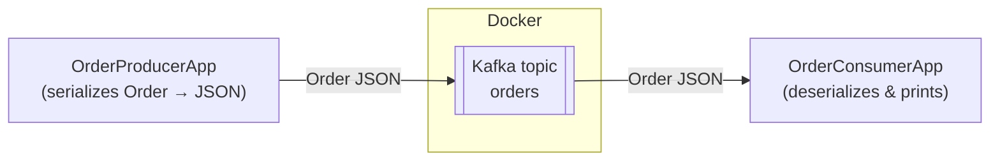

# EDA with Apache Kafka

Event-Driven Architecture (EDA) demo built with **plain Java** and **Apache Kafka**.
A **Producer** application publishes custom Java objects (`Order`) to a Kafka topic, and a
**Consumer** application reads those objects back and prints them to the console.

> i2i Academy homework project. This repository contains only source code and
> configuration — the assignment document is intentionally excluded.

## Architecture



The two applications are decoupled: the producer does not know who (if anyone) consumes
its events, and the consumer can be started, stopped, or scaled independently. That
loose coupling is the core idea of Event-Driven Architecture.

## Theoretical knowledge

**What is Event-Driven Architecture (EDA), and why do we need it?**
EDA is a design style where services communicate by producing and reacting to *events*
instead of calling each other directly, which decouples components in both time and
location. We need it because it enables scalability, resilience, and asynchronous
processing — a slow or failed consumer never blocks the producer.

**Why has Apache Kafka become an industry standard, and what does it do better than
alternatives (e.g., RabbitMQ, ActiveMQ)?**
Kafka is a distributed, partitioned, replicated commit log that delivers very high
throughput while durably retaining events so multiple consumer groups can replay them,
whereas traditional brokers typically delete messages once acknowledged. This
combination of horizontal scalability, durability, and replay makes it the default
backbone for event streaming at scale.

## Tech stack

- Java 17
- Apache Kafka client (`kafka-clients`)
- Jackson (JSON serialization of custom objects)
- Docker Compose (Kafka broker + Kafka UI)
- Maven

## Prerequisites

- JDK 17+
- Maven 3.9+
- Docker & Docker Compose

## Getting started

### 1. Start the Kafka broker

```bash
docker compose up -d
```

This starts Zookeeper, a Kafka broker (reachable at `localhost:9092`), and Kafka UI
at http://localhost:8085 for inspecting topics and messages.

### 2. Build the project

```bash
mvn clean package
```

### 3. Run the Consumer (in one terminal)

```bash
mvn exec:java -Dexec.mainClass="com.i2i.academy.eda.consumer.OrderConsumerApp"
```

### 4. Run the Producer (in another terminal)

```bash
mvn exec:java -Dexec.mainClass="com.i2i.academy.eda.producer.OrderProducerApp"
```

The producer publishes a batch of `Order` objects; the consumer prints each one it
receives, for example:

```
Received [partition=0 offset=0 key=8f3c...] Order{orderId='8f3c...', customer='Ada Lovelace', product='Mechanical Keyboard', quantity=1, price=129.90, total=129.90, createdAt=2026-07-11T...}
```

### 5. Stop the broker

```bash
docker compose down
```

## Project structure

```
src/main/java/com/i2i/academy/eda
├── config/KafkaConfig.java              # shared broker/topic constants
├── model/Order.java                     # custom Java object exchanged over Kafka
├── serialization/JsonSerializer.java    # generic object -> JSON bytes
├── serialization/JsonDeserializer.java  # generic JSON bytes -> object
├── producer/OrderProducerApp.java       # publishes Order objects
└── consumer/OrderConsumerApp.java       # reads and prints Order objects
docker-compose.yml                       # Kafka broker + Kafka UI
```

## Cloud deployment

The same setup runs unchanged on a cloud VM: install Docker, copy `docker-compose.yml`,
run `docker compose up -d`, and either build the JARs on the VM or run the producer and
consumer against the broker's public address by updating
`KafkaConfig.BOOTSTRAP_SERVERS`.
